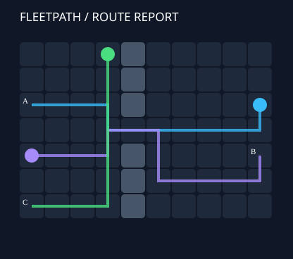

# FleetPath Lab

Plan collision-free robot routes on a grid with space-time reservations.




An executable, dependency-free Python engineering project. Runs locally; no API keys,
cloud account, or paid services are required. Python 3.11+.

## Quick start

From this repository's root:

```sh
python -m fleetpath examples/warehouse.json --output report.json --svg report.svg
python -m unittest discover -s tests -v
```

Optional installation: `python -m pip install -e .` exposes the `fleetpath-lab` command.

## What it does

- Reads warehouse maps and ordered robot missions from JSON.
- Searches position/time states with waiting, obstacle avoidance, and a finite horizon.
- Prevents shared-cell collisions and opposite-direction edge swaps.
- Reserves final goal cells for the remainder of the horizon.
- Writes an inspectable JSON plan and a static SVG path report.

## Design boundaries

Prioritized planning is deliberately incomplete: input order matters. A failure means
no route was found under this priority order and horizon, not that the overall problem
is unsolvable. Robots occupy one cell and move synchronously one cell per tick.
No robot dynamics, diagonal motion, live hardware, or globally optimal makespan claim.


## Repository map

- `fleetpath/core.py`: domain model and algorithms
- `fleetpath/__main__.py`: command-line interface
- `tests/`: behavior and regression tests
- `examples/`: reproducible input data
- `DESIGN.md`: tradeoffs and suggested exercises
- `.github/workflows/test.yml`: CI configuration (remote execution requires GitHub Actions)

## Status

Version 1.0 is a complete local demonstration within the documented scope.
It is not a production service. Local tests are reproducible with the command above;
CI status should be checked on the actual repository after publishing.
